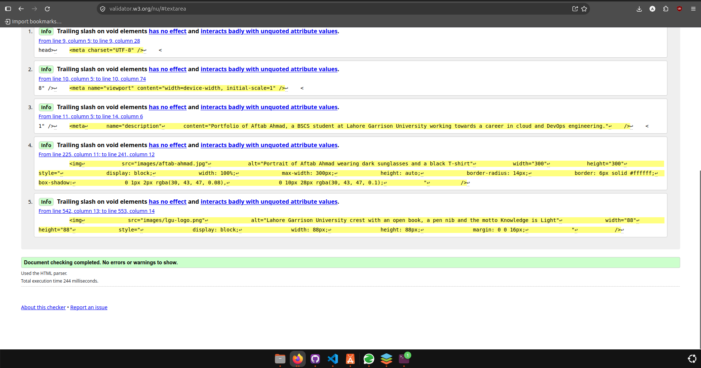
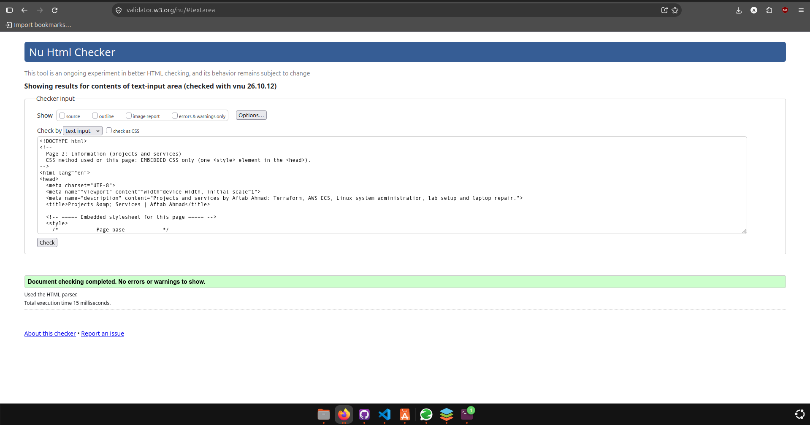
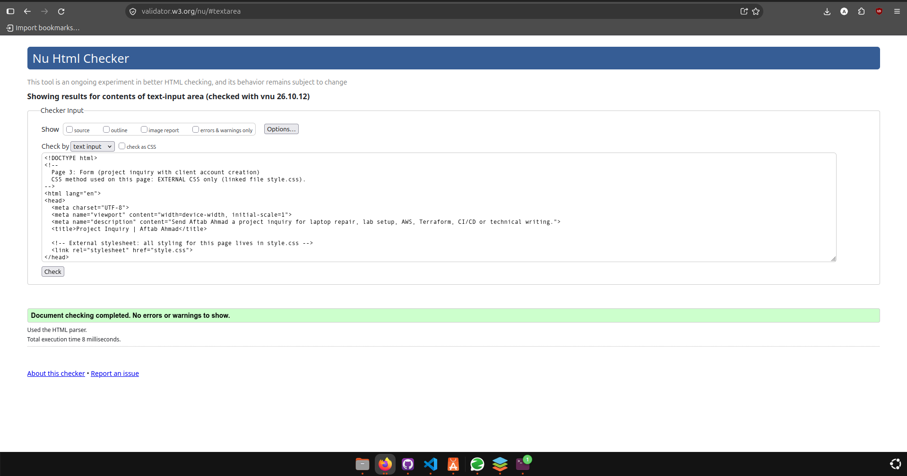

# Aftab Ahmad – Cloud & DevOps Portfolio

Web Technologies, Assignment 2: a three-page website built with HTML and CSS.

- **Student:** Aftab Ahmad (Fa24/BSCS/259), BSCS 5th semester, Lahore Garrison University
- **Repository:** https://github.com/devops-aftab/portfolio
- **Live site:** https://devops-aftab.github.io/portfolio/

## Pages

| File | Content | CSS method |
| --- | --- | --- |
| `index.html` | Home: introduction, skills, experience, education, hobbies | Inline (`style` attribute) |
| `information.html` | Projects and services: featured project article, aside, services table, audio and video | Embedded (`<style>` in `<head>`) |
| `registration.html` | Project inquiry form with client account creation | External (`style.css`) |

```
index.html
information.html
registration.html
style.css
images/    aftab-ahmad.jpg, lgu-logo.png
media/     terraform-demo.mp4, terraform-demo.webm, terraform-demo-poster.jpg, project-summary.mp3
screenshots/  W3C validation screenshots
```

## Short explanation

CSS (Cascading Style Sheets) is the language that controls how HTML looks: colours, fonts, spacing and layout. Keeping presentation separate from content makes pages easier to maintain, keeps the design consistent and lets one stylesheet restyle many pages at once.

In the rule `legend { color: #24564c; }` from my `style.css`, `legend` is the selector, `color` is the property and `#24564c` is the value.

Inline CSS is written in an element's `style` attribute and affects only that element, so it is quick but repetitive; I used it on `index.html`. Embedded CSS sits inside a `<style>` element in the `<head>` and styles a single page (`information.html`). External CSS lives in a separate `.css` file linked with `<link>`, so many pages can share it and the browser can cache it (`registration.html` uses `style.css`).

CSS1 (1996) covered the basics such as fonts, colours, margins and borders. CSS2 (1998) and its corrected version CSS2.1 (2011) added positioning, z-index, media types and more selectors. After CSS2.1 the language was split into separate modules, such as Selectors, Flexbox, Grid and Media Queries, that are developed and released independently. "CSS3" is just an informal name for this modular approach.

Browser support matters because browsers do not implement every feature at the same time or in the same way, and a website has to work for all of its visitors. I tested this site in Google Chrome and Mozilla Firefox.

A semantic example from my code is `<aside>` on the information page, which marks the tip box as related but secondary content. A non-semantic example is `<div class="field-row">` on the form page, which only groups two fields for layout and has no meaning of its own.

## Testing

### Form validation

| Test | Result |
| --- | --- |
| Submit with all fields empty | Blocked. Full name, Email, Password and Service are flagged as required. |
| Email `not-an-email` | Blocked. The browser asks for an `@` in the address. |
| Password `abc123` (6 characters) | Blocked. The browser asks for at least 8 characters. |
| Age `12` | Blocked. The value must be 16 or more (maximum 80). |
| Typing more than 500 characters in the comments box | Stops at 500 characters. |
| All fields valid | Confirmation message appears. No data is sent because the site has no server. |

### Browser differences

| Feature | Google Chrome | Mozilla Firefox |
| --- | --- | --- |
| Layout, colours, navigation | Same | Same |
| Audio and video | Play with controls | Play with controls; control bar looks different |
| Date picker | Calendar icon inside the field | Different calendar pop-up design |
| Validation messages | Chrome wording, e.g. "Please include an '@' in the email address" | Firefox wording, e.g. "Please enter an email address" |
| Number field arrows | Shown on hover | Always shown |

## Validation

All three pages were checked with the W3C Markup Validation Service (https://validator.w3.org/) and show no errors.





## Credits

- Photo and university crest supplied by the author.
- The video is a rendered terminal walkthrough of the Terraform workflow. The audio summary was generated with text-to-speech.
